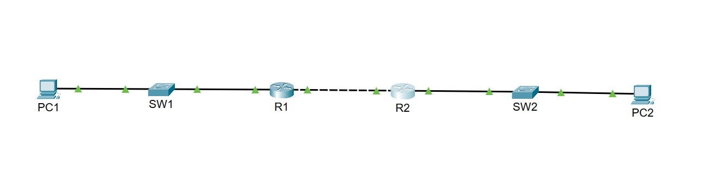
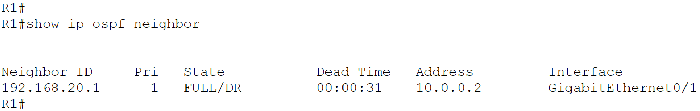
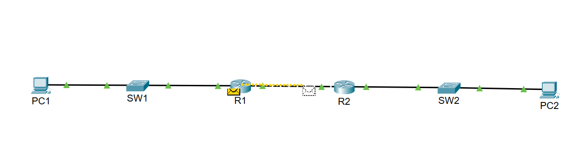

# Network Troubleshooting & Fault Isolation Lab

## 1. Project Overview

This project demonstrates network troubleshooting and fault isolation using Cisco Packet Tracer.

A small routed network is configured to provide communication between two LANs. A controlled network fault is introduced to simulate a connectivity issue. The fault is investigated using Cisco IOS CLI commands, resolved, and validated through end-to-end connectivity testing.

The project follows a structured troubleshooting approach relevant to Network Operations Center (NOC) and network support environments.

## 2. Project Objectives

- Build a routed network connecting two LANs.
- Configure router interfaces and IPv4 addressing.
- Establish dynamic routing using OSPF.
- Verify routing adjacency and end-to-end connectivity.
- Introduce a controlled network fault.
- Identify the root cause using CLI verification.
- Restore connectivity and validate the result.
- Document the troubleshooting process.

## 3. Tools and Technologies

| Tool / Technology   | Purpose                           |
|---------------------|-----------------------------------|
| Cisco Packet Tracer | Network simulation                |
| Cisco IOS CLI       | Configuration and troubleshooting |
| OSPF                | Dynamic routing                   |
| IPv4                | Network addressing                |
| ICMP / Simple PDU   | Connectivity verification         |

## 4. Network Topology

The topology consists of two LANs connected through two routers. Each LAN contains a PC and a switch. The routers exchange routing information using OSPF.

### Topology Diagram

PC1 — SW1 — R1 — R2 — SW2 — PC2



### Devices Used

| Device         | Quantity |
|----------------|----------|
| Cisco routers  | 2        |
| Cisco switches | 2        |
| PCs            | 2        |

## 5. IP Addressing Scheme

| Device | Interface     | IP Address    | Subnet Mask     |
|--------|---------------|---------------|-----------------|
| R1     | G0/0          | 192.168.10.1  | 255.255.255.0   |
| R1     | G0/1          | 10.0.0.1      | 255.255.255.252 |
| R2     | G0/0          | 192.168.20.1  | 255.255.255.0   |
| R2     | G0/1          | 10.0.0.2      | 255.255.255.252 |
| PC1    | FastEthernet0 | 192.168.10.10 | 255.255.255.0   |
| PC2    | FastEthernet0 | 192.168.20.10 | 255.255.255.0   |

### Default Gateways

- PC1: `192.168.10.1`
- PC2: `192.168.20.1`

The PCs are configured with static IPv4 addresses.

## 6. Routing Configuration

OSPF is configured between R1 and R2.

| Parameter            | Value       |
|----------------------|-------------|
| OSPF Process ID      | 1           |
| OSPF Area            | 0           |
| Inter-router Network | 10.0.0.0/30 |

The LAN networks are advertised through OSPF so that each router can learn the remote LAN route.

### OSPF Neighbor Verification

The OSPF neighbor relationship was verified using:

```text
show ip ospf neighbor
```

The neighbor state reached `FULL`, indicating that the OSPF adjacency was established.



## 7. Troubleshooting Scenario 1: Inter-Router Link Failure

### Scenario

A network connectivity issue was simulated by administratively shutting down the R2 interface connected to R1.

### Fault Introduced

The R2 interface `GigabitEthernet0/1` was placed in a shutdown state.

### Expected Impact

- The inter-router connection becomes unavailable.
- The OSPF neighbor relationship is interrupted.
- The routers cannot exchange routing information across the affected link.
- End-to-end connectivity between PC1 and PC2 is disrupted.

### Troubleshooting Approach

The following checks were used to investigate the issue:

1. Verify router interface status.
2. Check the OSPF neighbor relationship.
3. Identify the affected inter-router interface.
4. Restore the interface.
5. Verify that OSPF adjacency is re-established.
6. Test end-to-end connectivity.

### Verification Commands

```text
show ip interface brief
show ip ospf neighbor
show ip route
```

These commands help verify interface status, OSPF adjacency, and routing-table information.

### Root Cause

The R2 `GigabitEthernet0/1` interface was administratively shut down.

### Resolution

The interface was re-enabled using:

```text
no shutdown
```

### Recovery Verification

After the interface was restored:

- The OSPF neighbor relationship returned to the `FULL` state.
- Connectivity between the two LANs was restored.
- A Simple PDU test from PC1 to PC2 succeeded.

## 8. End-to-End Connectivity Test

A Simple PDU was sent from PC1 to PC2 using Cisco Packet Tracer.

The successful PDU result confirms that traffic could travel from the source PC through the routers to the destination PC after the fault was resolved.



### Validation Summary

| Validation                   | Result     |
|------------------------------|------------|
| Router interface recovery    | Successful |
| OSPF neighbor re-established | Successful |
| PC1-to-PC2 Simple PDU        | Successful |

## 9. Troubleshooting Methodology

The lab follows a structured troubleshooting workflow:

1. **Identify the symptom** — Determine which communication path is affected.
2. **Check interface status** — Verify router interfaces and link state.
3. **Verify routing adjacency** — Check the OSPF neighbor relationship.
4. **Inspect routing information** — Confirm that expected routes are available.
5. **Isolate the fault** — Identify the interface or configuration responsible.
6. **Apply the corrective action** — Restore the affected interface.
7. **Validate the recovery** — Confirm OSPF adjacency and end-to-end connectivity.
8. **Document the result** — Record the fault, root cause, resolution, and validation.

## 10. Project Files

- `Network-Troubleshooting-Fault-Isolation.pkt` — Cisco Packet Tracer lab file.
- `Packet_Tracer_Screenshots/` — Screenshots showing the topology, OSPF neighbor verification, and connectivity test.

## 11. Skills Practiced

- Network troubleshooting and fault isolation
- Cisco IOS CLI verification
- IPv4 addressing and subnetting
- OSPF neighbor and routing verification
- Router interface troubleshooting
- End-to-end connectivity testing
- Root-cause identification
- Technical documentation

